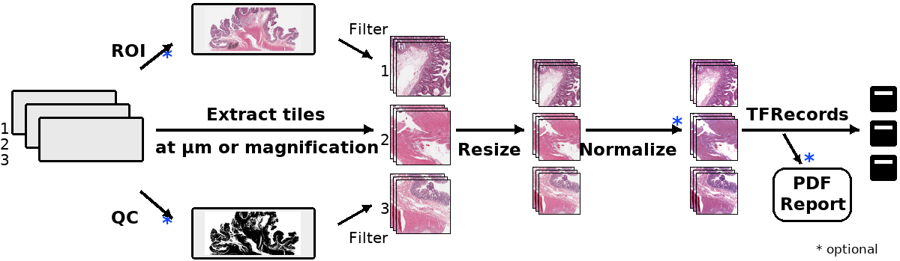
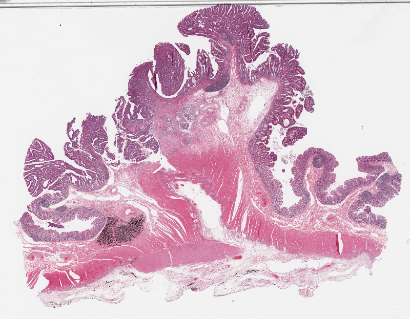
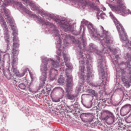
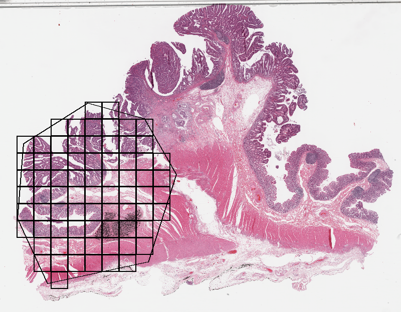
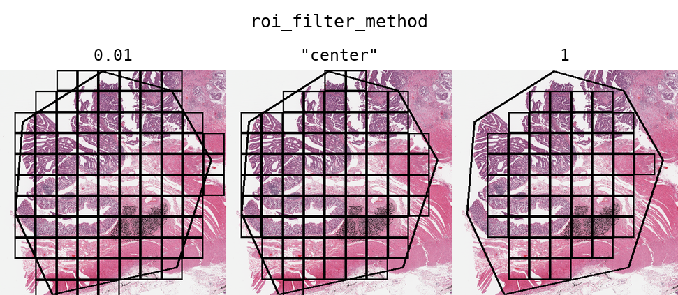
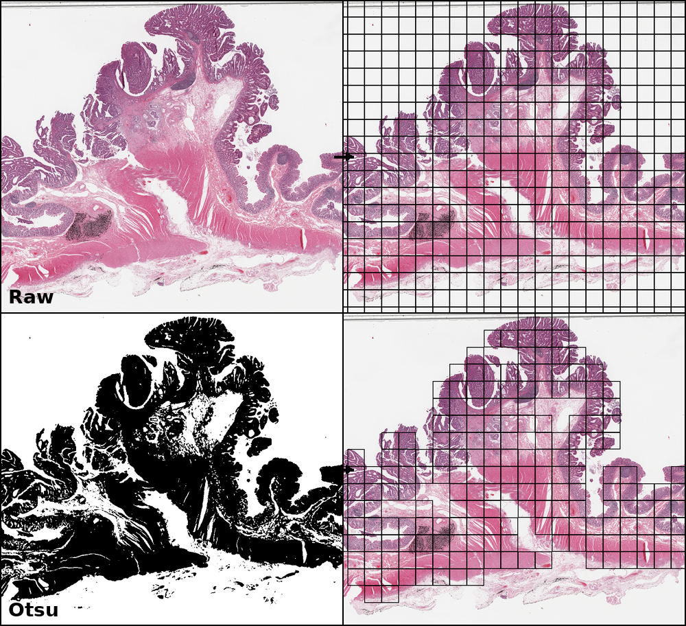
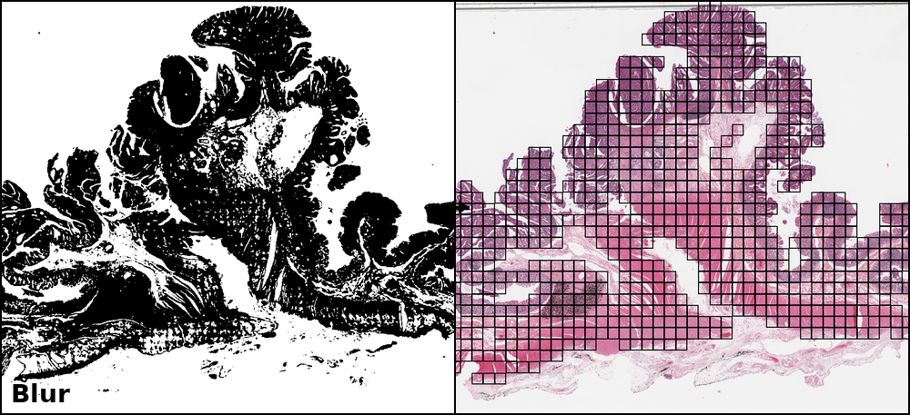
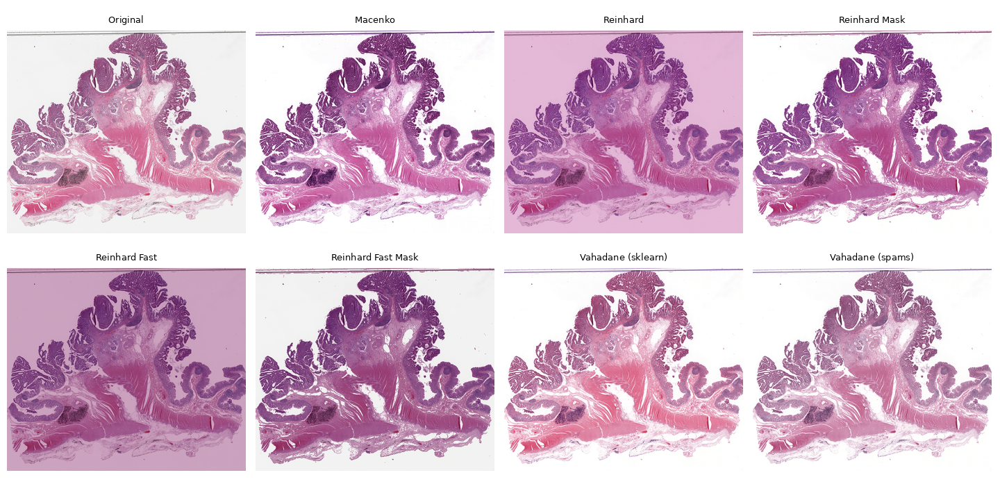
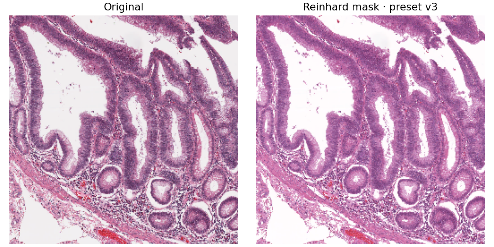

.. _filtering:

Slide Processing
================

   HistoX tile extraction, resizing, normalization, TFRecord export, and
   optional ROI, QC, and PDF-report steps.

Whole-slide histopathological images present many challenges for machine learning researchers, as these large gigapixel images may contain out-of-focus regions, pen marks, uneven staining, or varying optical resolutions. HistoX provides tools for both flexible and computationally efficient slide processing in order to build datasets ready for machine learning applications.

.. note::

   The figures on this page were generated with the current HistoX
   implementation, not copied from Slideflow. They use open-access TCGA slide
   images from the `NCI Genomic Data Commons <https://gdc.cancer.gov/access-data/gdc-data-portal>`_.
   The exact source filenames and processing parameters are recorded by
   ``docs/tools/generate_slide_processing_assets.py``.

Run this tutorial
*****************

The examples below form one continuous workflow around the exact TCGA-COAD
slide used in the figures on this page:
``TCGA-3L-AA1B-01Z-00-DX1.8923A151-A690-40B7-9E5A-FCBEDFC2394F.svs``.
It is an open-access diagnostic slide from the NCI Genomic Data Commons (GDC),
not a synthetic fixture. The first run downloads 1.23 GB through the built-in
HistoX data registry; later runs verify and reuse the local copy. GDC's
`data-analysis policies <https://gdc.cancer.gov/analyze-data/data-analysis-policies>`_
still apply to open-access files.

This page assumes that :doc:`HistoX is installed <installation>`. Download the
:download:`complete tutorial script <../examples/slide_processing_tutorial.py>`
and run it from any working directory. The data cache and generated results
are independent and may point to any writable locations:

.. code-block:: bash

   python slide_processing_tutorial.py \
       --data-dir /path/to/histox-data \
       --output-dir /path/to/histox-results

Omit ``--data-dir`` to use HistoX's normal cache resolution order:
``HISTOX_CACHE_DIR``, ``XDG_CACHE_HOME/histox``, then ``~/.cache/histox``.
The output directory contains thumbnails, QC masks, ROI and normalization
figures, 195 PNG tiles, a PDF extraction report, and a machine-readable
``results.json``. A successful run has this structure:

.. code-block:: text

   histox-results/
   ├── 01_thumbnail.png
   ├── 02_tissue_tile.png
   ├── 03_roi_tiles.png
   ├── 04_otsu_mask.png
   ├── 05_otsu_tiles.png
   ├── 06_otsu_gaussian_tiles.png
   ├── 07_stain_normalization.png
   ├── 08_extraction_report.pdf
   ├── results.json
   └── tiles/TCGA-3L-AA1B-01Z-00-DX1.../  # 195 PNG tiles

``results.json`` records the slide metadata, provider provenance, filter
counts, and exported-tile count, so it is the first file to compare when a
later run behaves differently. Start with the same imports and dataset
identifier used by the executable example:

.. literalinclude:: ../examples/slide_processing_tutorial.py
   :language: python
   :start-after: # BEGIN SETUP
   :end-before: # END SETUP

The core path on this page is: download one slide, inspect its metadata,
extract one tile, restrict the grid with an ROI, apply tissue and quality
filters, normalize one tile, and export the retained tiles. Sections marked
**Advanced** demonstrate optional capabilities and are not required for this
first run.

Choose separate writable locations for reusable data and generated results.
These are examples, not required paths:

.. code-block:: python

   data_dir = (Path.home() / "histox-data").resolve()
   output_dir = (Path.cwd() / "histox-slide-processing-output").resolve()
   output_dir.mkdir(parents=True, exist_ok=True)

.. note::

   Allow at least 1.3 GB in ``data_dir`` for the source slide and a partial
   download, plus space in ``output_dir`` for generated tiles and reports.
   Interrupted transfers resume from the sibling ``.part`` file when GDC
   returns HTTP byte ranges.

.. literalinclude:: ../examples/slide_processing_tutorial.py
   :language: python
   :start-after: # BEGIN DOWNLOAD
   :end-before: # END DOWNLOAD
   :dedent: 4

If the file already exists elsewhere, avoid a second 1.23 GB transfer by
passing it to the executable script:

.. code-block:: bash

   python slide_processing_tutorial.py \
       --slide /path/to/TCGA-3L-AA1B-01Z-00-DX1.8923A151-A690-40B7-9E5A-FCBEDFC2394F.svs \
       --output-dir /path/to/histox-results

Then open it once with an explicit pixel size and physical field of view:

.. literalinclude:: ../examples/slide_processing_tutorial.py
   :language: python
   :start-after: # BEGIN OPEN
   :end-before: # END OPEN
   :dedent: 4

``hx.WSI`` is the public HistoX interface for a whole-slide image. The values
below are chosen to keep this documentation run small and easy to inspect;
they are not universal training defaults.

.. list-table:: Meaning of the first ``hx.WSI`` configuration
   :header-rows: 1
   :widths: 18 14 34 34

   * - Argument
     - Tutorial value
     - Meaning
     - When to change it
   * - ``tile_px``
     - ``256``
     - Width and height, in pixels, returned to the model or saved tile.
     - Match the input size expected by the encoder.
   * - ``tile_um``
     - ``1024``
     - Physical width and height of tissue represented by each tile.
     - Choose a field of view appropriate for cells, tissue architecture, or
       the pretrained model.
   * - ``roi_method``
     - ``"ignore"``
     - Build the initial grid without restricting it to an ROI.
     - Use ``"inside"`` or ``"outside"`` after ROI annotations are available.
   * - ``use_edge_tiles``
     - ``True``
     - Keep boundary tiles that overlap the slide edge.
     - Disable it when every exported tile must contain a complete field of
       view.
   * - ``verbose``
     - ``False``
     - Suppress library progress messages in this compact tutorial.
     - Enable it while diagnosing slide-reader or extraction problems.

Here, ``tile_um / tile_px = 4`` micrometres per output pixel. This deliberately
uses a broad, low-resolution field of view so the example has only 456 initial
grid positions. A cell-level or pretrained-encoder workflow will commonly use
a smaller ``tile_um`` and must record that choice with the model.

The verified slide metadata is:

.. code-block:: text

   dimensions: 95,615 × 74,462 pixels
   microns per pixel: 0.2527
   pyramid levels: 4
   tile grid: 24 × 19
   candidate grid positions: 456

``dimensions`` describes the full-resolution base layer; ``mpp`` is the
scanner's native micrometres per pixel; ``pyramid levels`` are stored
downsampled views; and ``candidate grid positions`` is the count before ROI or
quality filtering. These values are useful sanity checks: a missing MPP or an
unexpectedly small dimension should be investigated before extraction.

   Actual ``01_thumbnail.png`` output from the verified tutorial run. The
   thumbnail confirms that the expected TCGA slide opened successfully before
   any ROI or quality filter is applied.

Every core code block on this page comes from that executable script. Sections
that require external model weights or optional frameworks are marked as
advanced and are not part of the default CPU run.

Most tools in HistoX work with image tiles—extracted sub-regions of a
whole-slide image—as the primary data source. This tutorial writes loose PNG
tiles so that every output can be inspected directly. Cohort workflows may
also write :ref:`TFRecords <tfrecords>` for higher-throughput training; that
transition is covered in `From one slide to a cohort`_.

Tile extraction
***************

Start by retrieving one tile directly from the shared :class:`histox.WSI`.
Indexing uses ``(grid_x, grid_y)``; use :meth:`histox.WSI.grid_to_coord` when
you need the corresponding base-level pixel location.

.. literalinclude:: ../examples/slide_processing_tutorial.py
   :language: python
   :start-after: # BEGIN TILE
   :end-before: # END TILE
   :dedent: 4

The verified tile has base coordinate ``(18234, 42546)`` and shape
``(256, 256, 3)`` with ``uint8`` RGB values. The complete export step appears
under `Extraction reports`_.

.. code-block:: text

   Tile: (4, 10) (18234, 42546) (256, 256, 3) uint8

   Actual ``02_tissue_tile.png`` output. Saving and inspecting one tile before
   a batch export catches coordinate, resolution, and colour-channel mistakes
   early.

See the :meth:`histox.Dataset.extract_tiles` API documentation for customization options.

.. note::

    Slide scanners may have differing microns-per-pixel (MPP) resolutions, so "10X" magnification from one scanner may be slightly different than "10X" on another scanner. Specifying a fixed ``tile_um`` ensures all image tiles have both the same pixel size and micron size. This MPP-harmonization step uses the `Libvips resize <https://www.libvips.org/API/current/libvips-resample.html#vips-resize>`_ function on extracted images. To disable this step and instead extract tiles at a given `downsample layer <https://dicom.nema.org/dicom/dicomwsi/>`_, set ``tile_um`` equal to a magnification level rather than micron size:

    .. code-block:: python

        magnification_slide = hx.WSI(
            str(slide_path),
            tile_px=299,
            tile_um="10x",
            verbose=False,
        )

.. _regions_of_interest:

Regions of Interest
*******************

Tile extraction can be optionally restricted based on pathologist-annotated Regions of Interest (ROI), allowing you to enrich your dataset by only using relevant sections of a slide.

We offer two methods for annotating ROIs - :ref:`HistoX Studio <studio_roi>` and `QuPath <https://qupath.github.io/>`_. Please see the HistoX Studio section for instructions on generating ROI annotations using the HistoX interface.

If you are using QuPath, annotate whole-slide images using the Polygon tool. Then, click **Automate** -> **Show script editor**. In the box that comes up, click **File** -> **Open** and load the ``qupath_roi.groovy`` script (QuPath 0.2 or greater) or ``qupath_roi_legacy.groovy`` (QuPath 0.1.x), scripts `available on GitHub <https://github.com/leicaohmu/histox>`_. Click **Run** -> **Run** if using QuPath 0.2 or greater, or **Run** -> **Run for Project** if using QuPath 0.1.x. ROIs will be exported in CSV format in the QuPath project directory, in the subdirectory "ROI".

Once ROI CSV files are generated, ensure they are placed in the folder expected by your :ref:`Project <project_setup>` or :ref:`Dataset <datasets_and_validation>` based on their respective configurations.

The ``roi_method`` argument to the ``extract_tiles()`` functions allow you to control how ROIs are used. Options include:

- ``'auto'``: Default behavior. For slides with a valid ROI, extract tiles from within ROIs only. For slides without ROIs, extract from the whole-slide image.
- ``'inside'``: Extract from within ROIs, and skip any slides missing ROIs.
- ``'outside'``: Extract from outside ROIs, and skip any slides missing ROIs.
- ``'ignore'``: Ignore all ROIs, extracting from whole-slide images.

.. note::

    Nested ROIs will be rendered as holes.

By default, ROIs filter tiles based on the center point of the tile. Alternatively, you can filter tiles based on the proportion of the tile inside an ROI by using the argument ``roi_filter_method``. If ``roi_filter_method`` is set to a float (0-1), this value will be interpreted as a proportion threshold. If the proportion of a tile inside an ROI is greater than this number, the tile is included. For example, if ``roi_filter_method=0.7``, a tile that is 80% inside of an ROI will be included, but a tile that is only 60% inside of an ROI will be excluded.

For a reproducible first run, create a seven-vertex polygon in base-level
pixel coordinates and apply it before extraction. Real projects normally load
the same information from HistoX Studio or QuPath instead.

The thumbnail call below needs the centre of every retained grid cell. Define
this tutorial-local visualization helper once before the ROI example. It is
not part of the HistoX public API and it does not change which tiles are kept:

.. literalinclude:: ../examples/slide_processing_tutorial.py
   :language: python
   :start-after: # BEGIN SELECTED_CENTERS_HELPER
   :end-before: # END SELECTED_CENTERS_HELPER

.. literalinclude:: ../examples/slide_processing_tutorial.py
   :language: python
   :start-after: # BEGIN ROI
   :end-before: # END ROI
   :dedent: 4

This example retains 74 grid positions whose centers fall inside
``ROI_tutorial`` and writes ``03_roi_tiles.png`` with the ROI boundary and
retained tile locations. Use :meth:`histox.WSI.get_tile_dataframe` to obtain
the coordinates, ROI name, and label as a dataframe.

The sequence is intentional: construct a fresh WSI, load the polygon, switch
``roi_method`` from ``"ignore"`` to ``"inside"``, then call
``process_rois()`` to rebuild the active grid. ``roi_filter_method="center"``
keeps a tile only when its centre lies inside the polygon.

.. code-block:: text

   ROI tiles: 74

   Actual ``03_roi_tiles.png`` output. The orange polygon is the tutorial ROI;
   the overlaid points are the 74 grid positions retained by the centre rule.

   The same ROI is evaluated using 1% proportional coverage, the tile-center
   rule, and 100% proportional coverage. ROI filtering and tissue QC are
   separate operations and can be combined during extraction.

.. _roi_labels:

ROIs can optionally be assigned a label. Labels can be added or changed using :ref:`HistoX Studio <studio_roi>`, or by adding a "label" column in the ROI CSV file. Labels can be used to train strongly supervised models, where each tile is assigned a label based on the ROI it is extracted from, rather than inheriting the label of the whole-slide image. See the developer note :ref:`tile_labels` for more information.

To retrieve the ROI name (and label, if present) for all tiles in a slide, use :meth:`histox.WSI.get_tile_dataframe`. This will return a Pandas DataFrame with the following columns:

    - **loc_x**: X-coordinate of tile center
    - **loc_y**: Y-coordinate of tile center
    - **grid_x**: X grid index of the tile
    - **grid_y**: Y grid index of the tile
    - **roi_name**: Name of the ROI if tile is in an ROI, else None
    - **roi_desc**: Description of the ROI if tile is in ROI, else None
    - **label**: ROI label, if present.

The **loc_x** and **loc_y** columns contain the same tile location information :ref:`stored in TFRecords <tfrecords>`.

You can also retrieve this information for all slides in a dataset by using :meth:`histox.Dataset.get_tile_dataframe`, which will return a DataFrame with the same columns as above, plus ``slide`` column.

Masking & Filtering
*******************

HistoX provides two approaches for refining where image tiles should be extracted from whole-slide images: **slide-level masking** and **tile-level filtering**. In these next sections, we'll review options for both approaches.

Otsu's thresholding
-------------------

   Actual HistoX output on the tutorial's TCGA-COAD slide: 456 candidate grid
   positions were reduced to 195 retained tissue tiles.

Otsu's thresholding is a **slide-based method** that distinguishes foreground (tissue) from background (empty slide). Otsu's thresholding is performed in the HSV colorspace and yields similar results to grayspace filtering, a tile-level filtering method described below.

Apply Otsu to a fresh WSI so that the before/after tile counts remain explicit:

.. literalinclude:: ../examples/slide_processing_tutorial.py
   :language: python
   :start-after: # BEGIN OTSU
   :end-before: # END OTSU
   :dedent: 4

The verified run reduces 456 candidate positions to 195 tissue positions and
writes both ``04_otsu_mask.png`` and ``05_otsu_tiles.png``. The mask is also
retained by the WSI object, so later calls to ``extract_tiles()`` use the
filtered grid automatically.

HistoX QC masks use ``True`` for pixels to exclude. Therefore
``apply_qc_mask(otsu_mask)`` removes background-covered grid positions; it does
not select the white pixels in the saved mask image.

.. code-block:: text

   Otsu tiles: 456 -> 195

Gaussian blur filtering
-----------------------

   On this open-access TCGA slide, Otsu retained 731 tissue tiles. For this
   visible demonstration, ``GaussianV2(mpp=8, sigma=3, threshold=0.12)``
   rejected 9 positions, leaving 722 tiles after combined quality control.

Gaussian blur masking is another **slide-based method** that can detect pen marks and out-of-focus areas, and is particularly useful for datasets lacking annotated Regions of Interest (ROIs). Apply Otsu first so that background is not treated as a blur candidate, then add ``GaussianV2``:

.. important:: Why this section starts from 731 rather than 195 tiles

   The first Otsu example uses ``tile_px=256, tile_um=1024``. This Gaussian
   demonstration intentionally creates a denser grid with
   ``tile_px=512, tile_um=512`` so that a small local blur region remains
   visible. The two counts describe different tiling configurations and must
   not be compared as if Gaussian added tiles. In an experiment, keep the
   tiling configuration fixed when comparing QC methods.

.. literalinclude:: ../examples/slide_processing_tutorial.py
   :language: python
   :start-after: # BEGIN GAUSSIAN
   :end-before: # END GAUSSIAN
   :dedent: 4

The script writes ``06_otsu_gaussian_tiles.png``. With the parameters above,
the current HistoX implementation reduces the Otsu-retained grid from 731 to
722 positions. Evaluate blur thresholds on representative cohort slides
before fixing them in a pipeline.

.. code-block:: text

   Otsu + Gaussian tiles: 731 -> 722

Two versions of Gaussian blur masking are available: ``qc.Gaussian`` and ``qc.GaussianV2``. The latter is the default and recommended version, as it is more computationally efficient. The former is provided for backwards compatibility.

By default, Gaussian blur masking is calculated at 4 times lower magnification than the tile extraction MPP (e.g., when extracting tiles at 10X effective magnification, Gaussian filtering would be calculated at 2.5X). This is to reduce computation time. You can change this behavior by manually setting the ``mpp`` argument to a specific microns-per-pixel value.

Gaussian blur masking is performed on gray images. The ``sigma`` argument controls the standard deviation of the Gaussian blur kernel. The default value of 3 is recommended, but you may need to adjust this value for your dataset. A higher value will result in more areas being masked, while a lower value will result in fewer areas being masked.

.. code-block:: python

  from histox.slide import qc

  # Customize the Gaussian filter,
  # using a sigma of 2 and a mpp of 1 (10X magnification)
  gaussian = qc.GaussianV2(mpp=1, sigma=2)

You can combine multiple slide-level masking methods. The executable Gaussian
section above demonstrates the single-slide form by applying the Otsu and
Gaussian masks in sequence. The cohort form accepts the same QC objects as a
list and is shown in `From one slide to a cohort`_.

If both Otsu's thresholding and blur detection are being used, HistoX will calculate Blur Burden, a metric used to assess the degree to which non-background tiles are either out-of-focus or contain artifact. In the tile extraction PDF report that is generated (see next section), the distribution of blur burden for slides in the dataset will be plotted on the first page. The report will contain the number of slides meeting criteria for warning, when the blur burden exceeds 5% for a given slide. A text file containing names of slides with high blur burden will be saved in the exported TFRecords directory. These slides should be manually reviewed to ensure they are of high enough quality to include in the dataset.

Grayspace filtering
--------------------

Grayspace filtering is a **tile-based method** that detects the amount of grayspace in a given image tile and discards the tile if the content exceeds a set threshold. RGB image tiles are converted to the HSV spectrum, and the fraction of pixels with saturation below a certain threshold is calculated. This filtering is performed separately for each tile as it is being extracted. Relevant arguments for grayspace filtering include:

- ``grayspace_threshold``: Saturation value, below which a pixel is considered gray. Range 0-1. Defaults to 0.05.
- ``grayspace_fraction``: Image tiles with grayspace above this fraction will be discarded. Defaults to 0.6.

Grayspace filtering is enabled by default, and can be disabled by passing ``grayspace_fraction=1`` to the ``.extract_tiles()`` functions.

Grayspace filtering is similar to Otsu's thresholding, with both operating in the HSV colorspace. Otsu's thresholding is ~30% faster than grayspace filtering for slides with accessible downsample layers, but if downsample layers are not stored in a given slide or are inaccessible (e.g. ``enable_downsample=False``), grayspace filtering may be faster. Grayspace filtering is more reliable than Otsu's thresholding for slides with abundant pen marks or other artifact, which can present issues for the Otsu's thresholding algorithm.

Compare disabled, grayspace, and whitespace filtering with a dry run. No tile
files are written in this step:

``count_filtered_tiles`` is a tutorial-local helper, not a HistoX API. It uses
``build_generator(dry_run=True)`` to decode and count eligible tiles without
writing them:

.. literalinclude:: ../examples/slide_processing_tutorial.py
   :language: python
   :start-after: # BEGIN COUNT_FILTERED_TILES_HELPER
   :end-before: # END COUNT_FILTERED_TILES_HELPER

.. literalinclude:: ../examples/slide_processing_tutorial.py
   :language: python
   :start-after: # BEGIN PIXEL_FILTERS
   :end-before: # END PIXEL_FILTERS
   :dedent: 4

The printed counts make parameter changes auditable. Use
:meth:`histox.WSI.preview` with the same keyword arguments when you also want
an annotated thumbnail of the retained positions.

.. code-block:: text

   Pixel filters: 195 195 188

Whitespace filtering
--------------------

Whitespace filtering is performed similarly to grayspace filtering. Whitespace is calculated using overall brightness for each pixel, then counting the fraction of pixels with a brightness above some threshold. As with grayspace filtering, there are two relevant arguments:

- ``whitespace_threshold``: Brightness value, above which a pixel is considered white. Range 0-255. Defaults to 230.
- ``whitespace_fraction``: Image tiles with whitespace above this fraction will be discarded. Defaults to 1.0 (disabled).

Whitespace filtering is disabled by default.

The ``whitespace_filtered`` branch in the preceding executable block uses
``whitespace_fraction=0.5`` and ``whitespace_threshold=230``. Adjust the
fraction first; changing both parameters simultaneously makes cohort-level
comparisons harder to interpret.

Stain normalization
*******************

   The same whole-slide thumbnail shown without normalization and after the
   seven Macenko, Reinhard, and Vahadane variants available through the HistoX
   normalizer interface, using the available HistoX presets (``v3`` for
   Macenko/Reinhard and ``v2`` for Vahadane).

Image tiles can undergo digital Hematoxylin and Eosin (H&E) stain normalization either during tile extraction or in real-time during training. Real-time normalization adds CPU overhead during training and inference but offers greater flexibility, allowing you to test different normalization strategies without re-extracting tiles from your entire dataset.

Available stain normalization algorithms include:

- **macenko**: `Original Macenko paper <https://www.cs.unc.edu/~mn/sites/default/files/macenko2009.pdf>`_.
- **macenko_fast**: Modified Macenko algorithm with the brightness standardization step removed.
- **reinhard**: `Original Reinhard paper <https://ieeexplore.ieee.org/document/946629>`_.
- **reinhard_fast**: Modified Reinhard algorithm with the brightness standardization step removed.
- **reinhard_mask**: Modified Reinhard algorithm, with background/whitespace removed.
- **reinhard_fast_mask**: Modified Reinhard-Fast algorithm, with background/whitespace removed.
- **vahadane**: `Original Vahadane paper <https://ieeexplore.ieee.org/document/7460968>`_.
- **augment**: HSV colorspace augmentation.
- **cyclegan**: CycleGAN-based stain normalization, as implemented by `Zingman et al <https://github.com/Boehringer-Ingelheim/stain-transfer>`_ (PyTorch only)

The Macenko and Reinhard stain normalizers are highly efficient, with native Tensorflow, PyTorch, and Numpy/OpenCV implementations, and support GPU acceleration (see :ref:`performance benchmarks <normalizer_performance>`).

Apply one normalizer directly to the verified RGB tile before enabling it for
an entire cohort:

The next helper only saves a side-by-side Matplotlib figure. It is included so
that the normalization block can be copied without an undefined name:

.. literalinclude:: ../examples/slide_processing_tutorial.py
   :language: python
   :start-after: # BEGIN SAVE_COMPARISON_HELPER
   :end-before: # END SAVE_COMPARISON_HELPER

.. literalinclude:: ../examples/slide_processing_tutorial.py
   :language: python
   :start-after: # BEGIN NORMALIZATION
   :end-before: # END NORMALIZATION
   :dedent: 4

This writes ``07_stain_normalization.png`` as an original/normalized
side-by-side comparison. The preset determines the target stain statistics;
record it with every experiment. ``reinhard_mask`` estimates stain statistics
without letting white background dominate them, and ``fit("v3")`` loads the
bundled HistoX v3 target rather than fitting the current tile as the target.

   Actual ``07_stain_normalization.png`` output from the code above. Compare
   tissue colour while also checking that white background remains neutral.

During tile extraction
----------------------

Image tiles can be normalized during extraction by using the ``normalizer``
and ``normalizer_source`` arguments. ``normalizer`` is the algorithm name;
``normalizer_source`` is either a reference image or a bundled preset such as
``"v1"``, ``"v2"``, or ``"v3"``. The cohort example at the end of this page
shows these arguments on :meth:`histox.Dataset.extract_tiles`.

:ref:`Contextual stain normalization <contextual_normalization>` is supported when normalizing during tile extraction.

On-the-fly
----------

The stain normalization implementations in HistoX are fast and efficient, with separate Tensorflow-native, PyTorch-native, and Numpy/OpenCV implementations. In most instances, we recommend performing stain normalization on-the-fly as a part of image pre-processing, as this provides flexibility for changing normalization strategies without re-extracting all of your image tiles.

Real-time normalization can be performed by setting the ``normalizer`` and/or ``normalizer_source`` hyperparameters.

.. code-block:: python

    from histox.model import ModelParams
    hp = ModelParams(..., normalizer='reinhard')

If a model was trained using a normalizer, the normalizer algorithm and fit information will be stored in the model metadata file, ``params.json``, in the saved model folder. Any HistoX function that uses this model will automatically process images using the same normalization strategy.

When stain normalizing on-the-fly, stain augmentation becomes available as a training augmentation technique. Read more about :ref:`stain augmentation <stain_augmentation>`.

The normalizer interfaces can also be accessed directly through :class:`histox.norm.StainNormalizer`. See :py:mod:`histox.norm` for examples and more information.

Performance optimization
************************

Tile extraction relies on random-access reads. Store slides on SSD when
possible; for cohort extraction, an optional SSD or RAM-disk ``buffer`` can
temporarily stage each slide. The batch example appears in
`From one slide to a cohort`_. Do not use ``/dev/shm`` as permanent storage:
its contents may disappear after a reboot. The single-slide tutorial keeps
reusable downloads under ``--data-dir`` (or the resolved HistoX cache) and
generated artifacts under ``--output-dir``.

Extraction reports
******************

Once tiles have been extracted, HistoX generates a PDF report with a summary
and representative tiles from each slide. Review this report for data
corruption, stain-normalization artifacts, and background-filtering problems.
The report is saved in the TFRecords directory. Its exact layout reflects the
installed HistoX release and the current cohort, so generate it from your own
extraction instead of relying on a static legacy screenshot.

The executable tutorial exports the Otsu-retained positions as inspectable PNG
tiles and builds a one-slide PDF report from the returned
:class:`histox.slide.report.SlideReport`:

.. literalinclude:: ../examples/slide_processing_tutorial.py
   :language: python
   :start-after: # BEGIN EXPORT
   :end-before: # END EXPORT
   :dedent: 4

The verified run writes 195 PNG tiles under
``tiles/TCGA-3L-AA1B-01Z-00-DX1.8923A151-A690-40B7-9E5A-FCBEDFC2394F/``
and saves ``08_extraction_report.pdf``.

.. code-block:: text

   Exported tiles: 195
   Report: histox-slide-processing-output/08_extraction_report.pdf

From one slide to a cohort
**************************

The executable tutorial above intentionally does not create or load a
``Project``. Use the three HistoX layers for different scopes:

.. list-table:: HistoX objects by scope
   :header-rows: 1
   :widths: 18 35 47

   * - Object
     - Scope
     - Responsibility
   * - :class:`histox.WSI`
     - One whole-slide image
     - Read metadata, manage ROIs and QC masks, inspect or export tiles.
   * - :class:`histox.Dataset`
     - A selected cohort of slides
     - Filter slides and annotations, batch-extract tiles, and build reports.
   * - :class:`histox.Project`
     - Persistent study configuration
     - Store dataset sources, annotation and output paths, model directories,
       and evaluation directories; construct a Dataset from those settings.

Create a project once using :func:`histox.create_project` or the
:ref:`project setup guide <project_setup>`. Later sessions should load that
existing project and request a Dataset with explicit tile geometry:

.. code-block:: python

   import histox as hx
   from histox.slide import qc

   project = hx.Project("/path/to/existing-project")
   dataset = project.dataset(tile_px=256, tile_um=1024)

``Project`` itself does not open the tutorial SVS. ``project.dataset(...)``
reads the project's configured sources and annotations and returns the cohort
object that performs the batch operation. The current source recommends
calling :meth:`histox.Dataset.extract_tiles` directly:

.. code-block:: python

   reports = dataset.extract_tiles(
       save_tiles=True,
       save_tfrecords=False,
       roi_method="auto",
       qc=[qc.Otsu(), qc.GaussianV2()],
       normalizer="reinhard_mask",
       normalizer_source="v3",
       buffer="/path/to/ssd-buffer",  # Optional; must fit the largest slide.
       report=True,
   )

This applies one recorded tiling configuration to every selected slide,
returns a mapping of slide names to extraction reports, and writes outputs to
the locations configured by the Dataset. Set ``save_tfrecords=True`` for the
TFRecord training path; leave ``buffer=None`` when slides already reside on
fast storage.

For an existing TFRecord cohort, regenerate a report without reopening the
single-slide tutorial object:

.. code-block:: python

   dataset.tfrecord_report("/path/to/report-output")

This separation keeps exploratory single-slide choices out of the persistent
cohort configuration until they have been visually reviewed and fixed for the
study.

Advanced extensions
*******************

Complete the executable CPU tutorial before adding the dependency-gated
methods below. They are useful extensions, but they require model weights,
extra runtimes, or labeled training data and are not part of the verified core
run.

Cell-centred extraction
-----------------------

Instead of extracting a regular grid, HistoX can extract tiles around detected
cell centroids. This branch requires Cellpose dependencies and model weights;
follow :ref:`cellseg` for installation and mask-review guidance.

.. code-block:: python

   from histox.cellseg import segment_slide

   cell_slide = hx.WSI(
       str(slide_path),
       tile_px=256,
       tile_um=64,
       verbose=False,
   )
   segmentation = segment_slide(
       cell_slide,
       model="cyto2",
       gpus=None,
   )
   segmentation.save(str(output_dir / "cell_masks.zip"))
   cell_slide.apply_segmentation(segmentation)
   cell_slide.extract_cells(
       tiles_dir=str(output_dir / "cell_tiles"),
       img_format="png",
   )

The ``tile_um`` value controls the physical field of view around each detected
cell. Inspect the saved masks before using centroid tiles for training.

DeepFocus
---------

HistoX also provides an interface for using `DeepFocus <https://journals.plos.org/plosone/article/file?id=10.1371/journal.pone.0205387&type=printable>`_ to identify in-focus regions. DeepFocus is a lightweight neural network that predicts whether a section of a slide is in- or out-of-focus. When used as a slide-level masking method, DeepFocus will filter out-of-focus tiles from a slide. By default, DeepFocus is applied to slides at 40X magnification, although this can be customized with the ``tile_um`` argument.

.. code-block:: python

    from histox.slide import qc

    deepfocus = qc.DeepFocus(tile_um="20x")
    slide.qc(deepfocus)

Retrieve raw predictions by passing ``threshold=False``:

.. code-block:: python

    predictions = deepfocus(slide, threshold=False)

Custom deep learning QC
-----------------------

Create a custom deep learning QC method by inheriting
:class:`histox.slide.qc.StridedDL`. The following skeleton recreates the
DeepFocus loading pattern after its optional package and checkpoint have been
installed:

.. code-block:: python

    from histox.slide.qc import strided_dl
    from deepfocus.keras_model import load_checkpoint, deepfocus_v3

    class CustomDeepFocus(strided_dl.StridedDL):

        def __init__(self):
            model = deepfocus_v3()
            checkpoint = "/path/to/deepfocus/checkpoints/ver5"
            load_checkpoint(model, checkpoint)
            super().__init__(
                model=model,
                pred_idx=1,
                tile_px=64,
                tile_um="40x",
            )

Supply this class to :meth:`histox.WSI.qc` for one slide or to the ``qc``
argument of :meth:`histox.Dataset.extract_tiles` for a cohort. See :ref:`qc`
for the complete customization API.

Segmentation models
-------------------

HistoX provides interfaces for training and applying segmentation models such
as U-Net, FPN, and DeepLabV3 for slide-level masking. Training requires labeled
ROIs, a configured PyTorch environment, and a cohort Dataset. Follow
:ref:`segmentation` for that separate workflow.
